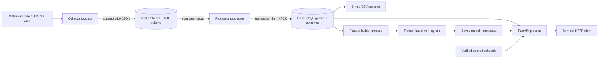

# Architecture and explanation

Week 6 alone can use a SQLite durable outcome ledger with exported staging CSV and JSONL. The default local ledger is not a substitute for Week 7 PostgreSQL: set DATABASE_URL for the required separate store. CSV exports are snapshots; the ledger is authoritative. Only one exporter should run. `--export` after every message is useful for a small Week 6 demo, while large/concurrent ingestion should export once afterward.

The collector owns source HTTP and cache provenance. The processor owns validation and delivery decisions, independently of collector internals. The storage component owns transactions and keys. The feature builder owns pregame timing and window definitions. The trainer owns preprocessing, fitting and evaluation. FastAPI loads the saved model and fetches validated history. The terminal client only displays responses; its picks come from the model.

## Delivery, transactions and concurrency

Redis stores stream entries with a JSON `payload` and group progress, not relational game rows. PostgreSQL stores unique games and a per-delivery outcome ledger. For buffering collector output during processor downtime, Redis permits asynchronous appends and later reads; PostgreSQL alone would need a polling/work-queue design. For historical season aggregates and joins, PostgreSQL supports SQL, indexes and multirow transactions; Redis Streams would require application scans or additional materialized keys.

Processing commits an accepted game and delivery outcome in one transaction, then acknowledges. Unique `game_id` accepts the first valid completed delivery only; unique `stream_id` makes replay a no-op. A transaction-scoped PostgreSQL advisory lock serializes attempts at the same stream ID. Concurrent different stream IDs for one game race on the game primary key: one is accepted and the other recorded duplicate. A failed outcome insert rolls back its related game insert. A crash after commit but before XACK is safe to replay. An invalid record cannot reserve a game key.

The processor scans XAUTOCLAIM with a default 60-second idle threshold, including entries held by a dead consumer. It also repeats recovery while running. `--claim-idle-ms 0` is for controlled tests only. Long processing can cause a live worker's entry to be claimed; transactional idempotency still protects effects. `--once` drains new messages and currently eligible pending entries; younger pending entries require a later run. XACK updates group progress, it does not delete an entry. Seen = accepted + rejected + duplicate counts distinct committed stream outcomes, not stream length.

Redis AOF uses appendfsync always and a named volume; PostgreSQL has a named volume and its normal WAL/commit behavior. Container restart preserves these volumes. Destroying volumes or the host without backups can lose buffered messages and relational data; CSV/model copies and source provenance allow reproducible rebuilding but cannot recreate arbitrary manually injected messages. There is no distributed transaction between Redis and PostgreSQL; at-least-once delivery plus idempotent storage closes that gap. This prototype has no authentication, failover, backups or multiple-host redundancy. Ports bind to loopback. A production design would add replicated stores, backups, health/readiness checks, restricted network access and several stateless API workers using a shared versioned artifact.

## Queries and partition design

`sql/queries.sql` contains a filtered season/team query, aggregate season query, feature-history query and EXPLAIN ANALYZE. `(season,gameday)` supports season filtering in date order. A small table may correctly use a sequential scan; observed evidence, not a promised index scan, determines the explanation. For much larger multi-league history, range partition by season could prune season-specific reads and simplify archival. It adds operational complexity and cross-season history still needs multiple partitions. Implementation is optional in the rubric and is not needed for roughly 7,500 games.

Model/API restarts do not stop collector ingestion. A model/store failure returns HTTP 503 instead of a fabricated probability. Invalid input returns 422; an unknown snapshot matchup returns 404. API calls after the model cutoff can replay historical games: this is explicitly labeled and is not a fresh forecast. Schedule cache updates are separate from model retraining.
